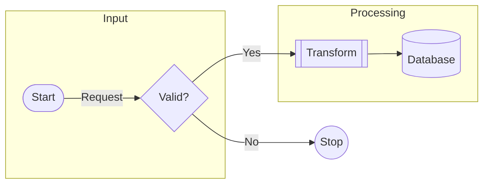

# F01.2 使用与边界

沿用 `parse(text, config=...)`、`render(text, backend=...)`、`await arender(...)`，返回 PNG bytes 和不可变语义/测量/布局/绘制 trace。同步入口须有 `if __name__ == '__main__'` 保护，以满足 Windows ELK worker 要求；异步不转移 Canvas 原生对象到其他线程。



运行仓库示例：

```powershell
$env:PYTHONPATH='src'
C:/venvs/pymmd-20261102/Scripts/python.exe tools/workflow.py record --scope F01.2 --name example -- C:/venvs/pymmd-20261102/Scripts/python.exe examples/enhanced_flowchart.py --backend cpu --out test-runs/my-enhanced-flowchart.png
```

14 种经典语法：`A[x]`、`A(x)`、`A([x])`、`A[[x]]`、`A[(x)]`、`A((x))`、`A(((x)))`、`A{x}`、`A{{x}}`、`A>x]`、`A[/x\]`、`A[\x/]`、`A[/x/]`、`A[\x\]`。节点和边支持普通 Unicode、实际换行及 `\n` 显示换行；引号内可含普通标点。HTML/Markdown/math 不在本切片范围。

子图支持显式 `subgraph S[标题]`、单词 ID、自动 ID、嵌套、重复声明合并、空组以及组端点引用。成员与顺序遵循固定 FlowDB 规则；重复组保留首次闭合的标题和方向。`flowchart.inheritDir` 默认为 false，true 时无显式方向的组继承全图方向。根方向仍限 TD/LR，组内支持 TD/TB/LR/RL/BT；跨层路由使用真实 ELK container 坐标。

`RenderResult.annotations` 分别给出组标题和边标签测量；`layout.groups` 含组框、标题框、原始 engine origin；`layout.edge_labels` 为独立标签框。所有最终布局为绝对 logical px；`MeasuredNode.outline` 和 `label_box` 为 node-local 值，不含 Canvas 原生对象。

经典 ellipse `A(-text-)` 在固定上游语法中存在，但其 shape registry 缺处理器。Python 保留解析、明确报告 `UPSTREAM_SHAPE_MISSING`，对照报告单独展示官方与 Python 的渲染错误，不生成成功图片。

复用测试和报告：

```powershell
C:/venvs/pymmd-20261102/Scripts/python.exe tools/workflow.py batch --python C:/venvs/pymmd-20261102/Scripts/python.exe --plan tools/plans/f012-tests.json --keep-going
C:/venvs/pymmd-20261102/Scripts/python.exe tools/workflow.py render --scope F01.2 --python C:/venvs/pymmd-20261102/Scripts/python.exe --fixtures tests/f012/cases.json --profiles cpu auto gpu --title "流程图增强 · F01.2 对比"
```

报告保留官方 SVG/PNG、Python 原图/trace/布局、源候选指纹和真实退出码；HTML 单文件内嵌原始 PNG，可离线查看。默认在 `reports/<run-id>/index.html` 发布到现有 8765 本地服务。安装验证继续暂缓；本轮不提交推送或发布包。验收及最终证据见 [F01_2_ACCEPTANCE](F01_2_ACCEPTANCE.md)。
