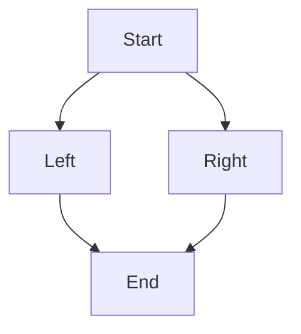

> 2026-11-05 用户已决定 **完全剥离 Dagre 功能、配置选项、目标依赖和算法回退**，不再暂停待评估，也不作为可选兼容任务。默认 ELK 与其他保留的专用静态算法继续推进。见 [布局策略](LAYOUT_POLICY.md)；下文旧 Dagre 计划/来源说明以此覆盖。

> 2026-11-05 用户范围决策：**全部图种和共享模块只做静态渲染，忽略交互逻辑。** 点击/回调/悬停/导航/命中测试、动画播放、交互元数据与 DOM 无障碍行为不作为交付或验收项；静态画面、资源与输入安全保留。以 [静态范围规则](STATIC_RENDERING_SCOPE.md) 为准，覆盖本文旧交互要求。

> 2026-11-05 **F01.3 已完成本地验收**：产品 279 项 + 工具 25 项通过；50 正例/8 语法负例/6 范围外诊断/1 上游缺陷在 CPU、auto、GPU 全通过。[验收记录](F01_3_ACCEPTANCE.md)。F01.4/Dagre 暂停，安装验证继续暂缓，本轮未提交推送。下方旧状态保留为历史。

> 2026-11-04 **F01.2 已完成本地验收**：产品 150 项 + 工具 17 项通过；35 正例/8 语法负例/1 上游渲染缺陷在 CPU、auto、GPU 全通过。[验收记录](F01_2_ACCEPTANCE.md)。安装验证暂缓，本轮未提交推送；后续 F01.3 尚未开始。下方执行中说明保留为历史。

> 2026-11-04 当前执行范围为 F01.2 流程图增强，已完成 F01.1 基线；以 [F01.2 执行计划](F01_2_EXECUTION_PLAN.md) 与当前账本为准。安装验证继续暂缓。以下旧范围和时序保留为历史资料。

> 2026-11-04 当前执行范围仅F01.1基础流程图，已实现接口见 [使用说明](F01_1_USAGE.md)，本地结果见 [验收记录](F01_1_ACCEPTANCE.md)。安装验证按用户最新要求暂缓，后续不继续或复跑。下方完整迁移范围和旧时序仅作后续规划/历史来源，当前以 [F01.1计划](F01_1_EXECUTION_PLAN.md) 为准。

# 按 Mermaid 功能拆分与首个迁移功能

> 最新执行顺序以 [FULL_MIGRATION_PLAN](FULL_MIGRATION_PLAN.md)和 [机器任务图](../references/migration-execution.json)为准：P1 先写完全部图种/公共功能源码，P2 再根据原实现设计测试/单测，P3 统一排查修复，P4 最终全量。F01.1 仅是第一条源码接线；下列功能切片不作为逐图先测通过的串行门禁。

2026-11-04。先确定用户能使用的功能，再沿[完整依赖树](DEPENDENCY_MIGRATION.md)向下选取所需模块，底层向上实现。D00…D10 是可复用的技术工作包；本文件用 F 编号表示图种功能，用 C 编号表示共享模块。机器清单见 [feature-modules.json](../references/feature-modules.json)。

用户已明确 [Canvas 原生架构](CANVAS_NATIVE_ARCHITECTURE.md)：抛弃 DOM/虚拟 DOM、D3 selection、fastdom、浏览器排版与截图机制。各共享模块围绕语义数据、样式、测量、布局和绘制指令重新组织，上游 DOM helper 不逐一移植或建立 Python 替身。

功能验收按 [渲染一致性规则](RENDER_CONSISTENCY.md)：普通/复杂标签、节点边内容、方向/连接和可读性必须正确，跨 DOM/Canvas 的坐标/自然尺寸/抗锯齿差异不要求消除，不以像素相等作为首图或完整迁移门槛。

## 1. Mermaid 的大功能

| 功能 | 包含图种 | 主要依赖方向 | 推进次序 |
| --- | --- | --- | --- |
| F01 流程图 | flowchart-v2、flowchart-elk 别名 | 配置/grammar/图模型 → 测量 → py-elk → 路径与 Canvas | **首先迁移基础切片，再扩全** |
| F02 关系与建模图 | class、state、ER、requirement、usecase、C4 | 复用语义图、分组、节点标签、布局与路由；按图种选择实际算法 | 流程图基础链建立后 |
| F03 时序图 | sequence | 专用消息/激活/循环模型与排布，复用标签、路径和绘制 | 流程图基础链建立后，可作为另一图种验证复用 |
| F04 时间与过程图 | Gantt、journey、timeline、gitGraph | 日期/时间、分支/泳道或专用排布 | 对应基础能力建立后 |
| F05 数值图表 | pie、quadrant、XY、radar | D3 所用数值、比例尺、轴、弧、刻度 | 对应 D3 数值子集建立后 |
| F06 树与层次图 | mindmap、treeView、treemap | 树/层级、tidy、COSE 等按实际源码接入 | 对应树/力导向能力建立后 |
| F07 流量与集合图 | Sankey、Venn | d3-sankey、集合布局/几何 | 对应专用算法建立后 |
| F08 结构与架构图 | block、packet、kanban、architecture | 栅格/分栏/位宽；architecture 的 Cytoscape/fCoSE | 各自专用布局建立后 |
| F09 专用业务图 | swimlane、agentflow、eventmodeling、ishikawa、wardley、cynefin | 各自语法/模型/几何，复用共享标签与渲染 | 独立功能逐个展开 |
| F10 语法轨道图 | railroad、EBNF、ABNF、PEG 四入口 | grammar 组合与轨道几何 | 对应语法与几何建立后 |
| F11 ZenUML | 外部 ZenUML 插件 | ANTLR/自有语法、专用模型/布局、额外宿主链 | 单独的高风险工作线 |
| F12 信息与诊断 | info，另保留 error/--- 诊断入口 | 配置、版本、异常和文字绘制 | 随共享诊断/导出补齐 |

38 个 detector 在机器清单中各归属一次，13 项跨图能力各有共享模块负责。依赖方向是功能级规划，不能据此声称同组图种使用同一布局或已完成逐 symbol 可达性审计。后续 F02…F12 的精确先后按已实现模块的复用收益决定，当前只锁定 F01 优先。

## 2. 共享功能模块

| 模块 | 职责与产物 | 对应底层工作包 | 首个功能需要的范围 |
| --- | --- | --- | --- |
| C01 输入/配置/诊断 | 预处理顺序、配置默认/覆盖、位置和错误 | D00/D02 | 保留默认 layout、主题、标签模式和间距；定义位置映射和显式未支持诊断 |
| C02 检测/解析 | detector、lexer、grammar、语义动作 | D04 | flowchart/graph 与 TD/LR、矩形、普通文字、有向边；按锁定 Jison 行为建立契约 |
| C03 模型/图结构 | 有序节点边、引用、方向、分组和 source spans | D00/D03 | 有序平面图和稳定 ID；没有子图的首批用例先闭环 |
| C04 标签/主题 | Python 文本 run/box、富文本/数学布局、解析后的主题样式 | D01/D02/D05/D08 | 普通标签直接由 Canvas 测量；htmlLabels 等配置映射为标签解释/排版语义，不创建 DOM |
| C05 布局/路由 | 图模型/选项 → 布局引擎 → 节点/标签/边几何 | D03/D06/D07 | 复用 py-elk，转换方向/间距/尺寸/边和返回路由；不重写 ELK |
| C06 图形几何 | 形状、节点交点、路径、marker、手绘 | D01/D06 | 矩形、边路径、普通箭头、节点边界裁剪、坐标变换 |
| C07 绘制/输出 | Canvas primitives、viewport、PNG/其他导出、owner/状态 | D08/D09 | 创建线程上的真实绘制、PNG bytes、尺寸和连续运行状态隔离 |
| C08 静态资源/安全 | 字体/图标/图片、资源 URL/标签安全与必要静态格式信息；交互/a11y 行为排除 | D02/D05/D08 | 首批字体输入和安全标签路径；其余资源、交互等继续保留范围 |

模块之间的数据接口先限定为设计：图模型保留 ID、顺序、label、方向和源位置；测量结果携带真实 label box 与字体信息；布局结果携带节点/边/标签几何；绘制阶段消费布局结果并返回 bytes。不要跨线程传递 Canvas 对象。公开 API 签名沿用原契约的“待定稿”状态。

## 3. 第一步确定为 F01.1：基础流程图

交付目标是：**输入 Mermaid 流程图文本，通过 Python 解析和真实默认 ELK 布局，用 py-skia-canvas 输出 PNG。**

选择理由：流程图能贯通解析、配置、模型、标签、布局、几何、绘制整条链；这些模块后续可供多种图复用。ELK 和 Canvas 已有独立 Python 项目，可以把工作集中在 Mermaid 语义与适配。F01.1 仅实现目标用例所需的底层接口，不以完成整个 D3、CSS 或所有 parser 框架作为前提。

首批功能范围：

- `flowchart` / `graph` 入口，TD 与 LR 方向。
- 矩形节点及普通文字标签，单节点、两节点链、分支与合流。
- 有向边与普通箭头，正确处理节点边界、路由、画布包围盒及 padding。
- 默认 ELK 真正调用 py-elk；默认主题/look 与标签模式按固定源码解析。
- 真实字体测量和 PNG 输出；非法语法与未实现输入明确诊断。

首批目标输入示例（**计划用例，当前还不能渲染**）：

另有单节点、TD 链、LR 链和不完整边示意，共 5 个历史计划输入存于机器清单。它们不是 P1 的测试门禁；正式 assertion/期望和语法错误位置在全源码完成后的 P2 从固定来源拆出。P1 可以阅读这些输入理解源码规则，`graph` 别名等正式检测/解析用例仍在 P2 编写。

首批不宣称边标签、子图、全部形状、HTML/Markdown/math、全部主题、其他 ELK 算法、手绘、插件和其他导出已实现。这些依次由 F01.2…F01.4 补齐并保留在完整分母中。普通标签按默认配置含义转为 Python 文本 run/box，由 Canvas 测量和绘制；不模拟上游默认 DOM 路径，不强制修改 htmlLabels，也不任意剥除富文本内容。T1/T3 记录实际标签解释、样式和度量对应关系。

## 4. F01.1 内部执行顺序

| 任务 | 具体工作 | 前置与实际交付 |
| --- | --- | --- |
| F01.1-T1 源码契约与 parser-model | 阅读固定 grammar/spec 理解规则，定义配置/错误/源位置、lexer/parser、节点边模型和模块接口 | 对应 P1-01/P1-03/P1-F01-SEED；不提前编写正式用例和单测 |
| F01.1-T2 最小共享语义 | 按 T1 实际调用补 JS 值/顺序/ID、配置默认和纯 Python 几何接口 | 可以随 T1 增量完成；不预先建立全功能兼容层 |
| F01.1-T3 标签测量与样式 | 默认普通标签、字体匹配/测量、节点尺寸与 padding，正确处理默认标签路径 | T1 模型接口确定后；使用公开 Canvas API，不能将 oracle 尺寸放进生产数据 |
| F01.1-T4 py-elk 适配 | 从图模型和实测尺寸构造布局输入，映射方向/间距/选项，提取实际节点与路由 | 模型/测量接口固定后可准备适配；整合时必须调用真实 py-elk，不保留测试假坐标 |
| F01.1-T5 Canvas 绘制 | 矩形、label、边、箭头、背景、viewport 到 PNG bytes | T3/T4 结果；复用 C06/C07 的必要接口 |
| F01.1-T6 源码接线与待验记录 | 检查引用/签名/注册等机械集成，记录源映射和待验行为，继续 P1 其余图种 | 正式测试设计、功能/图像/错误与状态验证后置 P2/P3/P4，不以首图验收阻止全部源码编写 |

先锁定 T1 的图模型和测量/布局边界，随后 parser、测量/图形、ELK 适配可按接口独立推进。主集成者负责合并和真实输入到 PNG 的检查；独立任务不能同时修改同一模块，也不能将各自局部 mock 通过当成整合通过。本轮只确定范围，不启动这些实现任务。

最终验证本功能时仍须拿到：相同输入官方 A/Python B 语义/几何对照、真实 py-elk 与 Canvas 输出/图片、非法输入/位置/默认说明。这些工作在全部源码完成后的 P2/P3/P4 进行；P1 不要求先取得它们再写下一功能。P3 按影响面复跑，P4 最终全量；像素差异完整保留。

## 5. 如何扩展 F01 并接回总计划

| 切片 | 后续功能 | 与原任务的关系 |
| --- | --- | --- |
| F01.1 | 本文基础输入到默认 ELK PNG | M1/M2 的对应局部契约和 M3 第一内部批次 |
| F01.2 | 边标签、更多形状、子图/跨组边 | 扩展 C03/C04/C05/C06，补齐 M3 标签边/子图组 |
| F01.3 | frontmatter/directive/theme、HTML 标签开关和 Markdown 等相应入口 | 补原 M3 六组所需契约；默认行为不因分批而被改写 |
| F01.4 | 全部保留的 flowchart 静态语法/shape/config、ELK 选项/look/静态资源/静态导出（交互逻辑与交互元数据排除） | 对应 M4 和 M5-04 的 flowchart 扩全，逐项完成 |

F01.1 完成仍不等于 M1、M2、M3 或整个 flowchart 完成。首批六组总体门禁及所有图种分母沿用 [实施方案](IMPLEMENTATION_PLAN.md)、[TASKS](TASKS.md)和[兼容规则](API_COMPATIBILITY.md)，本次没有缩减功能或验收标准。

来源入口：`packages/mermaid/src/diagrams/flowchart/flowDetector-v2.ts`、`flowDiagram.ts`、`parser/flowParser.ts`、`parser/flow.jison`、`flowDb.ts`、`flowRenderer-v3-unified.ts`、`flowRenderer-elk-default.spec.ts`，以及 `rendering-util/layout-algorithms/elk/render.ts`、`schemas/config.schema.yaml` 和共享标签/图形 helper。默认 ELK 测试本身 mock 了绘制模块，只证明解析到布局注册表的选择，不能作为真实 ELK 布局或真实绘图证据。
