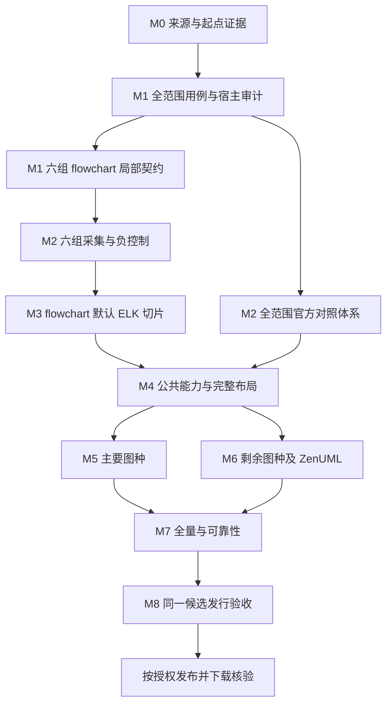

> 2026-11-05 用户已决定 **完全剥离 Dagre 功能、配置选项、目标依赖和算法回退**，不再暂停待评估，也不作为可选兼容任务。默认 ELK 与其他保留的专用静态算法继续推进。见 [布局策略](LAYOUT_POLICY.md)；下文旧 Dagre 计划/来源说明以此覆盖。

> 2026-11-05 用户范围决策：**全部图种和共享模块只做静态渲染，忽略交互逻辑。** 点击/回调/悬停/导航/命中测试、动画播放、交互元数据与 DOM 无障碍行为不作为交付或验收项；静态画面、资源与输入安全保留。以 [静态范围规则](STATIC_RENDERING_SCOPE.md) 为准，覆盖本文旧交互要求。

# 完整迁移实施方案

> **执行顺序已由用户更新：先完成全部功能源码，再设计测试/单元测试、统一排查修复，最后全量。当前执行权威为 [FULL_MIGRATION_PLAN](FULL_MIGRATION_PLAN.md)、[任务图](../references/migration-execution.json)和 [接管指令](EXECUTION_HANDOFF.md)。下文保留历史 M0…M8 的范围与来源发现，不能按其中旧的“先完成每图测试再推进”时序执行。**

> **渲染标准同样已更新：[功能一致，不要求跨 DOM/Canvas 完全像素一致](RENDER_CONSISTENCY.md)。下文旧的像素/坐标比较表述仅作历史参考；正常引擎差异可通过，功能/内容/关系/可读性错误仍失败。**

2026-11-02 梳理。本文是实施计划，不是实现或验收报告。任务编号与门禁见 [TASKS](TASKS.md)，实际能力只以 [RELEASE_STATUS](RELEASE_STATUS.md) 和 [compatibility.json](compatibility.json) 为准。

## 1. 目标、基线与当前起点

目标是把固定 Mermaid 的完整 spec 行为移植到 Python：预处理、检测、grammar、配置/主题、语义、布局、图形/标签、资源/安全、错误、元数据和导出。唯一生产渲染引擎为 py-skia-canvas。PNG/JPEG/WebP/SVG/PDF 等为待验收的目标格式。

| 项目 | 固定边界 |
| --- | --- |
| Mermaid | `12.2.0` / `1fb7869866dd619168d840291c9c54b4f129758b`，不追随在线最新版 |
| Canvas | `py-skia-canvas==0.1.0a18`，仅使用公开 Python API |
| 首轮平台 | CPython 3.13；Windows AMD64、Linux glibc 2.28+ x86_64，须本项目分别验收 |
| 生产依赖禁区 | Node/npm、浏览器/Playwright、JS 解释器、skia-python、`.local` 参考源码 |
| 研发 oracle | 可以使用锁定官方 Mermaid 与浏览器，不能成为产品 fallback |
| 底层职责 | Canvas 负责字体匹配/shaping、绘制、编码、设备选择；本项目负责 Mermaid 语义与图布局 |

[上游锁](../references/upstream.lock.json)和 [来源规则](../references/README.md)固定来源；现有索引有 37 个 core detector + ZenUML、368 个测试源文件、2,366 个渲染 fixture、38 个 grammar、34 篇 syntax 文档，共 2,806 个文件。文件数不是断言总数或通过率。

当前只有版本接口、模块职责、来源索引、bootstrap 与 Canvas 依赖示例。没有 Mermaid parser、layout、renderer、官方 JS 采集器或逐断言 ledger；所有图种 parser/layout/canvas 均为 planned。已有 wheel 只验证骨架打包，不可作为功能发布。

本轮修改前重新执行 bootstrap、12 项负控制、upstream fetch/check；Windows Canvas auto/CPU/GPU 冒烟输出均已保存并查看。它们不证明 Mermaid 兼容、native GPU 全路径、Linux 或 no-loader 通过。资料及源码审计证据见 [本轮记录](changes/20261102-migration-plan.json)。

## 2. 源码审计对计划的修正

以下事实来自锁定 checkout，不依据通用 Mermaid 印象推断：

| 事实与上游位置 | 对迁移顺序的影响 |
| --- | --- |
| `packages/mermaid/src/schemas/config.schema.yaml`：根 `layout` 默认 `elk`；完整构建包含 ELK，tiny 缺失时回退 Dagre | M3 默认 flowchart 必须纳入最小 ELK 路径；目标已排除 Dagre/原型/回退，不作为默认行为或可选兼容项 |
| `diagram-api/diagram-orchestration.ts`：实际优先级由 `addDiagrams` 中注册调用决定，且受构建开关影响 | 现有 import 提取器只提供 detector 分母；M1 另提取运行时顺序、别名、配置副作用与 full/tiny 差异 |
| `diagrams/git/gitGraphParser.ts` 含 `import.meta.vitest` 内联测试 | `.spec/.test` 文件索引不是全部测试入口；M1 扫描内联测试、动态用例及生成物并补独立断言清单 |
| `rendering-util/render.ts` 注册 Dagre、swimlane、cose-bilkent 和 ELK；architecture 使用 Cytoscape/fCoSE | M4 分别迁移专用泳道管线、复合图/力导向算法及其随机性、停止条件和路由 |
| `rendering-util/layout-algorithms/elk/algorithms.ts` 还列出多个 `elk.*` 算法 | `elk` 不等于全部 ELK 选项完成；别名、参数目录、各算法与插件均留在分母 |
| `themes/index.js` 注册 11 个主题键，含 neo/redux 系列 | 主题与 look 逐项盘点，不能仅完成传统几个主题 |

当前索引不改写、不冒充新增覆盖；审计发现的其他来源采用补充清单追踪。M1 仍需核对 config schema/defaultConfig、全部渲染 helper、构建逻辑、资源、snapshot 和传递依赖。

2026-11-04 补充：[第三方依赖盘点](THIRD_PARTY_DEPENDENCIES.md)和 [dependencies.json](../references/dependencies.json)已建立五个产品包的静态声明/版本/传递图/import/补丁清单；实际 bundle 与第三方许可证、资源审计继续保留 open。ELK 按用户决定使用独立 py-elk（分发名 `py-visactor-elk`）；本项目接入尚未实施，后续 M3/M4 验证适配的模型、选项、标签和路由，不要求 py-elk 回退 Mermaid 的旧 elkjs 版本。

## 3. 目标架构和运行契约

执行用户确认的 [Canvas 原生架构](CANVAS_NATIVE_ARCHITECTURE.md)：直接采用 Python 语义模型/样式/文本 box/布局几何/绘制指令，测量、绘制与编码统一交给 py-skia-canvas。淘汰 DOM/虚拟 DOM、D3 selection、fastdom、React 浏览器渲染和 HTML 截图；不为这些机制寻找 Python 兼容库。上游图语言、所用数值/布局算法、图形表达、配置与安全功能仍需保留并验证，生产不读取浏览器测量结果。

功能拆分与首个交付已具体化为 [F01.1 基础流程图](FEATURE_MIGRATION.md)：从 Mermaid 大功能选流程图，再选择矩形/有向边/TD-LR 所需的共享子集，实现文本到默认 ELK/PNG。机器功能表包含全部 38 个 detector 和 13 项跨图能力的归属；它只确定实施范围，不表示迁移已完成。

依赖实施补充见 [完整树与自底向上方案](DEPENDENCY_MIGRATION.md)：D00…D10 按值/几何/资源/图结构/解析/标签/数值/布局/宿主/组装/ZenUML 分解，逐项映射回本计划 M1/M3/M4/M5/M6。完整锁和额外源码链均已生成，不等于 bundle/许可证或候选等价已验证；不改变产品接口和兼容门禁。

```text
text + immutable configuration + explicit resource policy
  -> preprocess / detect / diagram grammar
  -> immutable typed semantic model + source spans + diagnostics
  -> text/style resolution and measurement <-> owner-thread Canvas adapter
  -> diagram-specific layout / routing / label placement
  -> typed display primitives + resolved styles + metadata
  -> owner-thread py-skia-canvas drawing and export
  -> bytes / dimensions / MIME / backend / diagnostics / metadata

development only:
same fixtures -> official JS + pinned browser -> model / SVG / geometry / RGBA
              -> isolated Python candidate  -> model / layout / RGBA / exports
                                             -> layered comparison and evidence
```

先测量标签再做依赖标签尺寸的布局；需要迭代测量的算法按源码保留阶段顺序。不得用浏览器测量结果、oracle 尺寸或固定样例坐标作为生产输入。离线 golden geometry 只用于测试。

| 模块 | 计划职责与主要产物 | 必须保持的边界 |
| --- | --- | --- |
| `parsing` | 预处理、frontmatter/directive、detect、词法/grammar、错误恢复及位置映射 | Jison/Langium/Chevrotain 等逐入口审计；不靠正则拼全部语法；区分原文位置和预处理位置 |
| `model` | 各图种类型、关系/嵌套、语义验证、diagnostics/source spans | 不持有 Canvas/GPU；未知或未支持字段不能静默丢弃 |
| `config` | schema、默认值/非 JSON 值、合并、theme/look/CSS、安全和资源策略 | 缺省/null/false/0/空串明确区分；不隐式联网或执行 script |
| `diagrams` | detector/别名、parser→model→layout→style 接线、能力查询 | 未完成项明确失败，不注册成功 stub；每个 detector 独立记状态 |
| `layout` | 图种专用算法、ELK/tidy/力导向、节点/组、路由/交点/label box | 端口、单位、排序、tie-break、seed 和浮点行为可追踪；不随意换布局库 |
| `rendering` | shape/path/marker/clip、计算后 style、受控文本排版、viewport、metadata | 不重新决定图语义；display list 为内部强类型数据，不做通用调用解释器 |
| `rendering/skia` | 公开 Canvas/Path2D API、测量、绘制、各格式导出与 owner 生命周期 | 不复制 Rust/Skia/shaping/编码/Vulkan；Canvas 缺口在其仓库独立处理 |
| 产品入口与 CLI（待建） | 生命周期编排、参数验证、bytes/显式文件、退出码 | 公共 API 由 M1 定稿；parse 不分配 Canvas，跨线程只传 bytes 或不可变语义数据 |

当前仅有上表前七项的目录占位说明。产品 API 草案见 [API_COMPATIBILITY](API_COMPATIBILITY.md)，不能把 `parse`/`render` 草案当现成功能。

每次渲染建立独立 config/diagram DB/随机状态；连续调用不能互相污染。Canvas、Context、Font 对象及测量/绘制/导出留在创建线程；缓存必须区分线程、字体 SHA、配置与后端。工作线程自行创建并释放对象。async、取消、超时、批量 API 的签名在 M1 明确后实现。

## 4. M1：把完整 spec 变为可执行契约

M1 交付四类关联清单；以下文件名为拟建产物，尚不存在。

| 清单 | 建议产物 | 必填内容 |
| --- | --- | --- |
| 用例与断言 | `references/spec-cases/`、`references/spec-assertions/` | 稳定 ID、源路径/case/symbol/行、canonical source SHA、输入/config/资源/seed、期望/错误、层级、依赖、状态、证据 |
| 移植 source map | `references/port-map.json` | upstream commit/path/symbol → Python 入口、依赖、默认值、参数/单位、返回/异常、UTF-16 边界、线程/所有权及独立回归 |
| 宿主行为和决策 | `docs/HOST_MAPPING.md`、`docs/decisions/` | SVG/DOM/CSS/HTML/math/交互的 Python 对应、可等价范围、open 差异及必要用户决策 |
| 依赖与资源 | `references/dependencies.json`、fixture 资源 manifest | 精确版本/包 integrity/源码 SHA、直接及传递许可、算法来源、字体/图片/图标 SHA 与再分发条件 |

拆分顺序：先遍历固定源码测试入口及内联测试，再展开参数化/动态生成器、多断言、负例、snapshot；将 fixture 的文本、配置来源与资源关联到 case。grammar、syntax doc、config/default/theme/style/renderer 中未被测试覆盖的公开行为新增独立契约项。仓库基础设施测试也登记归属和处理理由，不能静默删掉。

覆盖以稳定 assertion ID 计数，重复来源通过关联去重。分别报告总分母、已拆分、已实现、各层通过、失败、open、blocked 和未验；支持图种的计数不能替代 assertion 覆盖。新发现行为只扩展清单，不删除难项以提高比例。

JS 对应至少包括：undefined/missing/null、真值与 `||`/`??`、Number/NaN/Infinity/负零、对象键/遍历顺序、UTF-16 code unit 与 Python 字符索引、正则/转义、日期/时区/locale、PRNG 与 seed。源默认值必须同时读取 schema、defaultConfig 和调用处，不能仅复制 YAML。

解析器选型先做一个 Jison 与一个 Langium 入口的技术验证，检查词法状态、最长匹配/优先级、歧义、错误位置、恢复、AST 和许可。随后固定 Python 生成器或移植方式；允许开发时生成 Python 表，产品中不加载 JS parser 或解释器。

M1 完成门禁：所有已发现来源均有归属，动态用例已展开或保留明确待解决项；默认值/错误/来源可追踪，API 与宿主契约可评审，影响等价性的必要决策已取得。尚未解决的差异继续留在全量分母，不能标通过。

## 5. M2：建立可信官方对照和差分闭环

1. 固定官方 A 的实际发行物或源码重建物及两者对应关系；核对源码包含的 detector/主题/布局与发行物是否相符。记录实际 Node、npm/pnpm integrity、浏览器 revision、插件/传递依赖、字体、OS、locale/时区、viewport/density；不能静默换基线。
2. 为每个 case 建立共享输入包：原始文本及 SHA、config/theme/look/layout/seed、字体与资源、尺寸、预期错误。采集前清空状态并等待字体/图片/异步布局完成。
3. A 保存 detect/parse/语义 DB、最终 config、原始 SVG、DOM box/path/marker/computed style、PNG/RGBA、错误及环境指纹。不是每种图都可直接导出统一 AST，需为 DB/AST 建立显式适配，不从截图倒推语义。
4. Python runner 使用新候选包，在仓库外、无 Node/浏览器/参考源码的环境保存 model/layout/display primitives、输出/异常、Canvas engine、wheel/native/source/resource SHA。
5. 比较器依次检查模型/错误 → 几何/style → 原始 RGBA/尺寸和差异图 → 导出结构/指定栅格器结果；结构比较中动态 ID 的映射可追踪，原始文件不改写。
6. 同输入重采确定性用例；随机默认用例保留原行为，另用显式 seed 验算法，不暗改 seed 默认值。加入节点属性、label box、路由端点、尺寸、单像素、错误类型、字体 SHA 的故意破坏负控制。

浏览器与 Canvas 的文本、抗锯齿和 HTML 宿主不天然逐像素相同。M2 固定比较 profile 与完整差异报告格式；不得自行设置宽松阈值、裁图、平移、后处理或把近似称完全兼容。Python 同环境同后端的确定性用例要求精确像素；GPU 和 CPU 分别建基线。

M2 完成门禁：官方产物身份与源码关系可核查、重复采集稳定性有证据、负控制全部能检出破坏、Python runner 无 JS 运行依赖。捕获工具/对照命令实现前不在文档虚构可运行命令。要求详见 [oracle](../tools/oracle/README.md)。

## 6. M3：首个 flowchart 垂直切片

六组输入至少覆盖：基础有向图、带标签边、子图、错误语法、frontmatter/theme、HTML 标签开关。每组包含正负/边界及配置断言；六组通过只证明该子集，不能把整个 flowchart 标为完成。

实现顺序为：预处理/配置 → 实际 detect → grammar/语义 → 字体/style/label 测量 → 默认 ELK 的最小真实算法路径 → shape/route/marker → Canvas PNG → 候选包隔离运行。ELK 最小路径的支持范围由这些 case 的源码行为确定，剩余算法/选项全部保留。

目标已删除 Dagre 布局和回退原型。数据链路以真实 ELK 验证；未支持的布局请求必须明确失败。

M3 交付：真实 Python 源码、六组 assertion/官方 A/Python B、几何与完整像素差异、GPU/CPU 分组结果、可运行 Mermaid 示例和原始图片 provenance；错误语法和不支持项明确失败。至少检查尺寸非零、真实内容、标签/端点/分组、字体/owner 和无跨图污染。

## 7. M4：共享能力与布局算法工作包

M3 只实现所需的最小公共能力；M4 扩展为所有图种可复用的实现。高风险算法的来源/许可/技术验证从 M1 开始，不能等首图完成才发现不可行。

| 工作包 | 完整范围与依赖 | 验收重点 |
| --- | --- | --- |
| 几何与图形 | shape catalogue、Path2D、transform、intersections、marker、clip、group、viewport | 锚点、闭合、线宽/dash、叠放、边界/单位；不复制样例坐标 |
| 文本与宿主 | SVG text、多行、HTML foreignObject、Markdown、CSS 继承/box model、math | 受控 Python 排版，真实 Canvas 测量；不能剥标签后称等价；CJK/RTL/emoji/组合字符分别验 |
| 配置/主题/look | 所有 schema/defaultConfig、11 个主题键、themeVariables、classDef/style/CSS 级联、RoughJS | 默认值、优先级、颜色推导、handdrawn 路径与 seed；不只比最终填充色 |
| 原 Dagre/graphlib 来源 | 仅保留原始来源；目标布局算法与兼容 API 已排除 | 保留的图/求交需求由自有模型与纯几何处理 |
| ELK | `elk`/layered、选项目录/preset、端口/层级/反馈边/line hops、其他 `elk.*` 和外部插件 | 每个算法/选项独立断言；M3 的最小路径逐步扩全，不以替代库冒称完成 |
| 专用 swimlane | 层级/泳道顺序、尺寸、分层、坐标、正交路由与后处理 | 移植锁定专用管线；DDLT/fixture size 数据只作研发断言，不作生产尺寸来源 |
| 树与力导向 | tidy-tree、Cytoscape cose-bilkent、architecture/fCoSE | 算法、约束、seed、终止条件、分组/端口；不能用普通树布局替代复合图 |
| D3 与专用计算 | Sankey、hierarchy/treemap、scale/axis/arc/curve、Venn、时间轴/日期计算 | 数值/时间单位、排序、曲线、刻度与区域几何，逐依赖登记来源 |
| 资源/元数据/安全 | 图标/Iconify、图片、字体、URL/sanitizer、a11y、link/click | 离线显式资源、拒绝脚本、缺资源错误、各格式元数据；不可等价交互留 open |

不预设某个 Python 布局库天然等价；先核算法/默认参数/数值和许可，再决定移植或复用。需要改变默认值/范围的方案必须形成具体差异和用户决策。库无等价实现是工作量与阻塞项，不是删减功能的依据。

## 8. M5/M6：完整图种推进顺序

以下按复用关系分组，组内可调整实施顺序，但不改变 M5/M6 范围和 37 + 1 detector 分母。表内依赖需经逐图 source map 再细化。

| 批次 | detector ID（与 compatibility 一致） | 主要迁移内容/依赖 |
| --- | --- | --- |
| M3 起点 | `flowchart-v2` | 完整管线的首个限定切片；以后补齐全部 grammar/shape/config/layout/look |
| M5 关系图 | `classDiagram`, `stateDiagram`, `er`, `requirement` | 成员/命名空间、状态嵌套、基数/关系、约束及共享复合图/路由 |
| M5 时序与流程 | `sequence`, `gantt`, `journey`, `gitGraph`, `timeline` | 消息/激活/循环、时间日历、旅程、提交/分支与专用排布 |
| M5 数值与树 | `pie`, `quadrantChart`, `xychart`, `mindmap`, `sankey` | 数值/坐标/轴、树/力导向、流量布局；复用 D3 和共享标签 |
| M6 业务/分组图 | `c4`, `block`, `kanban`, `packet`, `architecture`, `radar`, `treemap` | 容器、栅格/分栏、位宽、服务/端口、极坐标和面积布局 |
| M6 扩展专用图 | `agentflow`, `swimlane`, `eventmodeling`, `treeView`, `ishikawa`, `venn`, `usecase`, `wardley`, `cynefin` | 各自 grammar/DB/几何、专用路由/区域、继承配置与复杂标签 |
| M6 语法图 | `railroad`, `railroadEbnf`, `railroadAbnf`, `railroadPeg` | 四种入口语法与组合规则、重复/选择/注释、语法图排布 |
| M6 别名/信息 | `flowchart-elk`, `info` | 显式关键字引起的配置副作用、优先级/别名；版本信息和输出 |
| M6 外部插件 | `zenuml` | 单独锁定 `@zenuml/core` 及传递许可，迁移 grammar/model/layout/render；不是直接调用 JS 插件 |

`error`、`---` 另外作为诊断入口覆盖。插件注册、布局 loader 注册、重复注册/未知插件错误及 full/tiny 行为也进入宿主/API 清单；Python 的扩展契约需在 M1 明确，不以只支持内置图消除扩展 spec。

每个 detector 使用同一交付模板：来源/断言 → grammar/合法非法输入 → typed model/默认值/错误 → layout/标签测量 → Canvas/style/资源 → 所有声明配置与导出 → 独立回归/真实示例 → 文档与 evidence。图种完成状态由全部适用断言汇总，局部用例通过不能提升整个图种为已完成。

## 9. M7：全量与可靠性验收

13 项跨图能力保持独立状态：预处理、配置、主题/CSS、文本/HTML/Markdown/math、无障碍、链接/交互/安全、图标/图片/资源、布局引擎、handdrawn seed、导出、诊断/UTF-16、线程/生命周期、离线部署。M3 起就纳入相关回归，M7 做完整矩阵闭环。

| 维度 | 必须独立记录的检查 |
| --- | --- |
| 语法/语义 | 全 grammar、合法/非法/不完整输入、嵌套/转义/注释、错误与源位置、JS 值/日期时区 |
| 布局/渲染 | 各图全部布局/选项、标签与资源、主题/look、几何/样式/marker/层叠、全部原始像素差异 |
| 字体 | 同许可/SHA 字体、缺字体/fallback、CJK/RTL/emoji、组合字符与字体测量差异 |
| 格式 | PNG/JPEG/WebP/SVG/PDF 声明能力、尺寸/density/透明/背景、页/字体/链接/metadata、向量结构与指定栅格器 |
| 平台/设备 | Windows/Linux、默认 auto、显式 CPU、GPU-required、no-loader；GPU 失败不允许回退后通过 |
| 生命周期 | owner 线程、worker 自建对象、GC/销毁、异常恢复、取消/退出、连续/并发渲染、状态隔离 |
| 安全/资源 | 脚本与恶意 HTML/URL、资源拒绝/缺失、离线、输入/边/深度/时间/内存/并发上限 |
| 性能 | 固定硬件/字体/后端的解析、测量、布局、绘制、导出耗时与峰值内存；先建基线，再确定需决策的目标 |

JPEG 等有损编码单独定义解码/编码和稳定性断言；不把 PNG 像素规则直接套用所有格式。随机模式区分显式 seed 的确定性测试和原始随机默认的行为检查，不能为通过回归改变默认随机性。

Canvas 默认 GPU/CPU 策略保留；CPU 用公开 setter。`engine` 是状态信息，不代替 native GPU 路径证据。Windows PDF/SVG 并发非确定性继续登记；`RAYON_NUM_THREADS=1` 只能作显式诊断，不能偷偷改产品默认线程数。缺平台/字体/硬件时标未验并继续独立工作。

M7 门禁：全部断言有可审查终态及对应源码/环境证据；失败/open/未验不得计为通过，无隐藏 skip。批准的不可等价映射继续公开其差异，全量完成声明按实际契约措辞，不能用 SSIM 或少量人工看图替代完整 spec。

## 10. M8：打包、发行验收与发布

产品接口先完成 bytes、显式文件与 CLI；公开参数/默认输出格式/异常/退出码在 M1 固定。打包仅包含必要 Python 代码、公开资源和许可，不含 Node、JS runtime、oracle、`.local` 或测试 golden 输入。运行时不依赖仓库 cwd，也不隐式下载字体/图片/插件。

构建新候选并记录源码树、wheel、依赖/native SHA；在两平台新环境、仓库外、`python -I` 且无 Node/浏览器/参考源码可访问的环境验真实渲染。对同一候选字节执行兼容/导出/owner/设备检查，再查包内容、METADATA/README/许可和可复制例子。源码或构建字节变化必须重做相关验收。

可以在真实功能子集验收后准备 alpha，但须列明图种/选项/格式/平台及剩余分母；不发布占位包。计划、实现、限定验证、发行接受、实际发布分别记状态。commit/push、远端 CI、Release/PyPI 和重新下载核 SHA 按当次用户授权执行。

## 11. 依赖关系、工作量与决策点



图表示依赖，不表示可以跳过全量 M1/M2。允许先用六组局部契约建立 M2/M3 的限定闭环以暴露技术风险；全局 M1/M2 仍待完成，其他项保持 planned，不把局部试验算整阶段通过。M4 需完成各图种所用工作包后再扩大对应 M5/M6 范围，完整全量阶段仍按各自门禁结项。

当前不承诺总工期：尚无逐断言总量和可测移植吞吐。M1 汇总 grammar/图种/依赖规模，M2/M3 用六组实际采集与移植记录估算单位成本，再按断言量、共享算法及高风险宿主拆工作量区间；ELK、HTML/math、ZenUML 单列，不能用“每图几天”平均外推。

| 决策点 | 先准备的可审阅材料 | 不改变约束时可直接推进的工作 |
| --- | --- | --- |
| HTML/CSS/math/DOM 交互无法完全对应 | 官方样例/结构、Python 可行表示、丢失行为、差异与影响用例 | 宿主盘点、受控排版/元数据原型、独立断言 |
| 浏览器/Canvas 视觉差异的接受标准 | 原始 RGBA/尺寸/差异图、字体/几何归因、固定 profile | 完整记录差异和精确语义/几何检查，不自行放宽 |
| 布局替代或默认/范围调整 | 原算法来源/选项、候选方案、数值/布局差异和许可 | 等价算法移植、最小技术验证；未支持项明确失败 |
| Canvas API 缺口或平台限制 | 最小复现、公开 API 缺口、依赖仓库任务与证据 | 继续不依赖该缺口的契约、解析、布局工作 |
| 基线升级、引擎变更、降低门禁、发布 | 独立变更方案/候选与实际影响 | 保持当前锁及未通过状态，按当前授权完成本地工作 |

普通实现选择无需反复确认；需要用户决定时先给出具体材料。没有决策不意味着删除差异或把它自动接受。

## 12. 每批交付和下一批任务

每批先保存脏树、源码与旧证据，再实现/比较；证据只写新 `test-runs/<run-id>/`，保留失败和原始差异。source map、独立回归、双语 README、中文契约/开发文档、例子/真实图片来源同批审阅；未受影响主题须说明具体理由。任务记录包含实际命令、退出码、源文件及证据 SHA、验收范围、限制和下一步。

下一批按 [TASKS](TASKS.md) 的 `M1-01` 至 `M1-06` 和 `M2-01` 至 `M2-04` 开始：建立 ledger/source map schema，补来源缺口及实际 detector 顺序，拆六组 flowchart 断言，定 API/宿主初稿，审计 ELK/HTML/字体依赖，锁定官方 A 并采集真实产物。随后完成比较器负控制与最小 ELK/Canvas 切片。当前计划整理不提升任何 Mermaid 兼容状态。
