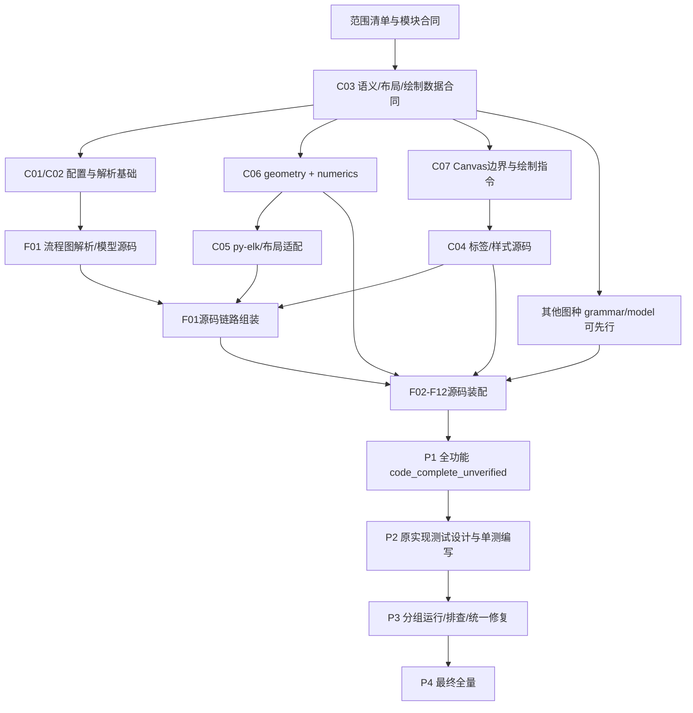

> 2026-11-05 用户已决定 **完全剥离 Dagre 功能、配置选项、目标依赖和算法回退**，不再暂停待评估，也不作为可选兼容任务。默认 ELK 与其他保留的专用静态算法继续推进。见 [布局策略](LAYOUT_POLICY.md)；下文旧 Dagre 计划/来源说明以此覆盖。

# 并行执行、阶段顺序与协同规范

2026-11-04。本文供后续执行会话直接分发任务。本轮只制定计划，没有实现产品。模块职责见 [MODULE_BOUNDARIES](MODULE_BOUNDARIES.md)，功能分母见 [FEATURE_MIGRATION](FEATURE_MIGRATION.md)和 [feature-modules.json](../references/feature-modules.json)，渲染遵循 [Canvas 原生架构](CANVAS_NATIVE_ARCHITECTURE.md)。

执行权威为 [FULL_MIGRATION_PLAN](FULL_MIGRATION_PLAN.md)与 [机器任务图](../references/migration-execution.json)。下述 W0…W8 是推荐 ready 队列组合，不能作为额外的串行全局门禁；具体任务 ID 和开工前置使用机器图。

渲染判定遵循用户已授权的 [功能一致规则](RENDER_CONSISTENCY.md)：跨 DOM/Canvas 不追求像素零差，正常引擎差异可通过；测试/修复角色优先处理内容、关系、可读性和安全/导出错误，不能为消掉不同像素而反复调整坐标或字体。

## 1. 用户指定的执行节奏

| 阶段 | 工作 | 可以开始下一阶段的条件 |
| --- | --- | --- |
| P0 范围与协作准备 | 读取上游、确认全部功能分母、拆源码任务、定义模块接口、分配文件 owner | 每项功能有源码任务和责任人；首轮接口/路径边界可执行 |
| P1 全部功能源码编写 | 公共模块和 F01…F12 全量实现，完成模型/布局/绘制/导出/安全等接线 | 全范围达到 `code_complete_unverified`；没有用成功 stub、固定坐标或遗漏图种替代实现 |
| P2 按原实现设计测试 | 从固定上游 grammar/spec/fixture/公开行为设计用例，编写单元测试、组件测试、oracle 和比较工具 | 所有功能和跨图能力有可执行测试及来源映射；测试设计与产品实现独立，等待 P3 分组运行 |
| P3 统一功能排查与修复 | 先分组运行测试/采集差异，归类根因，再集中修改公共模块和图种，针对变更执行相关回归 | 已知问题闭环；全量候选的相关局部检查通过，剩余风险有准确状态 |
| P4 最终全量验证 | 全功能、所有保留配置/布局、字体/资源/安全/导出/平台等统一检查 | 同一候选的完整验证有终态证据，失败/未验不计通过 |
| P5 交付与发行准备 | 候选包、真实示例、文档、许可/元数据和安装验证，按实际授权处理发布 | 对该候选的发行条件满足；提交、远端 CI、发布和下载核验各自记实 |

P1 不开展逐图测试用例设计、行为单元测试、官方图片采集、截图比较或每批全量验证。允许读取原实现理解算法、记录源符号映射，进行 `compileall`、import/类型/模块依赖/注册接线等机械检查。这些检查只说明源码能组装，不说明功能正确。

P0/P1 可以记录函数默认值、单位、异常职责和 source spans 等实现契约；正式的输入—期望—断言测试设计集中在 P2。旧文档中“先建立测试闭环才扩大功能”的顺序不再作为本次执行要求，以本阶段表和主实施方案为准。质量门槛保留在后续测试、修复、全量和发行阶段。

F01.1 仍是首先建立的源码链路，用于固定公共接口；它不是整个迁移的停止点。即使首图源码已经贯通，也继续完成其他所有功能源码，再进入 P2。`code_complete_unverified` 与“通过 Mermaid spec”必须分开记录。

## 2. 四个并发槽的角色配置

默认总共 4 个活跃槽：主协调 agent 1 个，worker agent 3 个。以下是职责，不要求始终创建相同名字的长寿命 agent；worker 结束后释放槽位，下一任务携带最新交接资料重新分发。

| 角色 | 持续职责 | 写入边界 |
| --- | --- | --- |
| 主协调/集成者 | 维护阶段、任务依赖、接口版本和 owner 表；分发 ready 任务；处理公共扩展请求；集成注册/API/包配置；组织批末复盘 | 任务状态、接口文档、总注册入口、`api.py`/`cli.py`、包元数据和明确由其领取的公共文件 |
| worker A：语法/模型/图种 | 共享语义和预处理、具体图种 grammar/model/装配；按队列切换功能族 | 当前任务领取的 `model/`、`config/`、`parsing/` 或 `diagrams/<family>/` 子目录 |
| worker B：计算/布局 | 纯几何/数值与图布局、py-elk 适配、专用路由 | 当前任务领取的 `geometry/`、`numerics/`、`layout/<algorithm>/` 文件 |
| worker C：排版/Canvas/资源 | 样式与标签、绘制指令、Canvas 后端、资源/安全；完成基础后可切换独立图种 | 当前任务领取的 `rendering/<submodule>/`、`resources/`、`security/`、`runtime/` 或独立图种目录 |

一个 worker 可以在不同任务中切换角色；同一时刻只领取一个明确写入集合。公共模块采用单 owner，角色表不授予整个大目录的永久写入权。主协调不占用 worker 的文件同时修改。

最忙的共享模块可以按独立文件拆任务。例如 `numerics/scales.py` 与 `numerics/curves.py` 可由不同 worker 处理，但 `numerics/__init__.py` 的汇总导出由唯一 owner 集成。不能把 `model/contracts.py` 同时交给三个 agent。

## 3. 可并行的依赖关系

下图表示接口与最终装配关系，不表示测试通过。机器任务图区分 `dependsOn`（该任务开始编码必须具备的前置，例如已冻结模型合同）与 `integrationNeeds`（最终接线必须实际落地的 provider，例如完整标签/布局实现）。消费者的源码任务不因为仅有 `integrationNeeds` 尚未完成而被阻止开工。C 编号沿用共享功能模块；D 编号是技术工作包，不要求先把每个 D 包整包迁完。



其他图种的 grammar/model 在合同明确后即可并行编码，不必等 F01 绘制器或全部布局算法完成。装配某图种时才需要它实际使用的标签、形状、路由和资源接口；其他图种有未实现的专用算法，不阻塞已经 ready 的工作。

共享接口定义可以先于具体实现落地；类型/协议不能返回伪成功结果。消费者可以依照合同写代码，写完可登记本模块 `code_complete_unverified`，但最终接线保留 `awaiting_provider`，不能创建返回固定布局/空图片的临时产品实现来假装接通。`P1-INTEGRATE` 检查所有 `integrationNeeds` 对应的真实提供方落实后，才登记全范围源码接线完成和 P1 退出。

## 4. P1 源码队列与推荐波次

表中 W 是调度队列的优先顺序，不是要求所有列同时结束的全局栅栏。某列前置满足就启动，其他列慢时释放空闲槽给另一个 ready 任务。每行可以按实际文件规模分成多个批次；不得借拆批漏掉完整图种范围。

| 队列 | worker A | worker B | worker C | 主协调的集成动作 |
| --- | --- | --- | --- | --- |
| W0 合同准备（P0） | 读取 parser/配置来源，列功能和源码符号职责 | 核对布局/几何输入输出及 py-elk 边界 | 核对 Canvas 公开能力、文字/样式/资源职责 | 固定首版数据合同、路径 owner、任务账本；不设计正式测试用例 |
| W1 公共基础 | C03 模型/顺序/源位置，C01 配置与共享预处理，C02 parser 工具 | geometry/numerics 最小纯计算、图结构操作 | display 数据、Canvas 后端与测量协议实现、runtime 基础 | 整合模块依赖；确认 model/纯计算不依赖 Canvas |
| W2 首个源码链 | F01.1 parser/model，再连续扩 F01 完整语法/语义 | py-elk 适配及 F01 所需真实路由/选项接口 | 普通标签、默认主题样式、形状/箭头/PNG 绘制源码 | 组装 F01.1 接线，再继续 F01.2…F01.4；不以实际绘图测试充当 P1 前置 |
| W3 关系/时序与布局 | F02：class/state/ER/requirement/usecase/C4 的专用代码 | ELK 及关系图所需的排序/复合图/路由适配 | F03 sequence 专用模型/排布；F12 info；需要时先处理排版扩展 | 将新增公共需求分派 owner；持续维护注册/API 接线 |
| W4 数值/日期与标签扩展 | F04：Gantt/journey/timeline/gitGraph | D3 所用数值/尺度/曲线/层级能力和 F05 数值图表 | 富文本/Markdown/HTML 含义、数学 box、主题/look、字体/资源/安全 | 合并公共扩展；保证调用方使用同一模型与样式职责 |
| W5 树/结构与力导向 | F06：mindmap/treeView/treemap 专用模型与组装 | 两套 COSE/layout-base、fCoSE、tidy 及其约束/seed/终止代码 | F08：block/packet/kanban/architecture 专用代码 | 按各图种真实前置接线，不强制所有树图共用同一算法 |
| W6 专用计算与业务图 | F07：Sankey/Venn 模型、配置及装配 | Sankey/Venn 数值布局、专用 swimlane/路由计算 | F09：swimlane/agentflow/eventmodeling/ishikawa/wardley/cynefin 的专用代码 | 处理新形状/分组/资源需求，保证专用实现与公共模块职责不混合 |
| W7 语法图与插件 | F10：railroad/EBNF/ABNF/PEG 四入口与几何装配 | F11：ZenUML grammar/model/布局的剩余计算工作 | F11：ZenUML 标签/style/Canvas 绘制与元数据装配 | 合并插件与外部注册职责，淘汰 React/DOM 机制，保留图形功能 |
| W8 源码范围收口 | 补全部 parser/config/diagnostics 与 source map 缺口 | 补布局/几何/数值选项和专用算法缺口 | 补全部主题、标签/资源/安全、导出/生命周期/离线代码 | 汇总 38 detector、13 跨图能力、全部适用算法/参数/格式；仅按源码完整性决定 P1 退出 |

ZenUML 风险高，可以在 W2 数据合同冻结后尽早领取独立 grammar/model 任务，不必机械等待 W7。如果其源码工作量较大，可让一个 worker 连续负责多个子任务，其他两槽继续公共模块和图种队列；W7 只代表最终合并它的剩余部分。其他图种的源码规模同样不按“一个图一天”估算，按原始语法/算法和已写代码量调整文件级分片。

例如 W7 同时分 ZenUML 时，worker B 只持有 `diagrams/zenuml/parsing/**`、模型/布局的明确文件，worker C 只持有 `diagrams/zenuml/presentation/**`；该图种聚合入口由指定 owner 单写。领取前将这些精确路径写入租约，不能两人都领取整个 `diagrams/zenuml/**`。其他大功能组同样按 detector/子目录派生子任务，父任务继续汇总所有子项。

每个族的“专用代码”必须包含其完整 grammar/模型/默认配置/错误路径、布局或专用排布、样式/形状/资源接线及适用导出，不仅是注册器或空 parser。F01.1 起点之外的合法/非法输入功能仍要编写；正式断言设计到 P2 才开展。

## 5. 每个可分发任务的输入、输出和退出标准

| 任务类型 | 输入 | 输出 | 前置 | 退出标准（P1） |
| --- | --- | --- | --- | --- |
| 公共数据/纯计算 | 锁定源码符号、已批准合同、需要的功能调用面 | 独立 Python 数据/算法文件、source map、已知差异和扩展清单 | 目录 owner 已分配；数据含义明确 | 所需分支真实编码；可编译；接口签名一致；状态 `code_complete_unverified` |
| 图种 grammar/model | 上游 grammar/DB/default/schema、F 族范围、公共 parser/model 合同 | `diagrams/<family>/` 中真实 parser/model/专用语义与装配代码 | C01/C02/C03 合同已固定；所需公共扩展有人接单 | 图种完整源码路径可追踪；不存在只支持首批样例却登记整图完成的情况 |
| 布局/路由 | 布局图/标签 box 合同、原算法选项/排序/seed、既有 py-elk 接口 | `layout/<algorithm>/`、必要纯计算扩展请求、真实适配 | 所需图结构和几何合同明确 | 实际算法及选项已编码；不返回 fixture 坐标，不因 ELK 未接通回退后冒称完成 |
| 样式/标签/资源 | 配置与 style/text/measurement 合同、原标签和资源行为 | typed style/text box、排版/资源安全代码 | 数据/Canvas 测量边界固定 | 可见内容与样式分支有真实代码；无 DOM/浏览器运行层、隐式下载或内容静默删除 |
| Canvas/导出 | display/viewport/资源合同、公开 Canvas API | 唯一 Canvas 后端、导出与生命周期代码 | 输入数据只含可传递语义/几何，native 对象 owner 明确 | 实际调用路径可追踪；没有替代 native 后端、白图 stub 或跨线程 Canvas 共享 |
| 注册/API/包组装 | 各图种和 provider 的实际文件、能力/错误合同 | 总注册器、产品入口、CLI、包资源与依赖声明 | 对应 provider 已交接；主协调拥有汇总文件 | 所有目标入口接线，有真实实现指向；源码完成与功能验证状态分离 |

如果完整范围还有 `TODO`/`pass`/`NotImplementedError`/固定返回等，检查它是否属于真正抽象协议或不适用行为。保留范围内尚未实现的业务分支必须登记 `code_incomplete` 并继续编写，不能因抛出了明确异常就作为全部功能源码完成。原实现本来拒绝的输入应保留真实错误逻辑。

## 6. 文件 owner、公共扩展和接口变更

执行会话在开始 P0 时建立任务账本（例如拟建 `docs/execution-state.json`），至少记录：

```text
taskId / phase / featureIds / scope / ownerAgent / writePaths / readPaths
dependsOn / integrationNeeds / interfaceVersion / providerTasks / status
sourceCommit-and-symbols / changedFiles / mechanicalChecks / evidence / nextAction
```

状态使用 `planned → ready → in_progress → awaiting_provider 或 code_complete_unverified`。P2 另加 `test_design_complete`，P3/P4 另加 `failure_recorded`、`fix_in_progress`、`targeted_verified`、`full_verified`；后四个状态必须附实际证据，不能由 P1 完成自动提升。执行状态与现有兼容清单分别维护，不把新状态硬塞进未更新 schema 的 compatibility stage 字段。

领任务前，主协调检查 `writePaths` 与活跃任务不重叠；图种 worker 只能写其族目录。对 `model/`、公共 `__init__.py`、总注册器、公共导出与 `pyproject.toml` 的修改，必须先向当前 owner 提交请求。请求包含：所需字段/参数/单位、默认值/错误、调用方、向后影响、可写文件建议、是否阻塞当前任务。

owner 的处理顺序是：核对是否已有能力 → 尽量增加兼容的新字段/操作 → 更新合同版本和提供方 → 广播受影响调用方 → 主协调统一接线。需要破坏性接口变更时，先列出全部消费者文件并安排一个短集成批；冻结相关写入，消费者适配完成后恢复任务，不让各 worker 自行维护同名旧接口。

公共扩展按数据/语义/算法职责归属，不为了省事把图种逻辑塞进 `common.py`。首次只有一个使用者时，代码可以留在该图种目录；第二个确有同语义调用者时，由 owner 提取最小公共能力并更新调用方。不同算法的相似代码不强行合并：两套 COSE 版本、不同 D3 分包版本的数值/排序差异先保留明确边界。

## 7. 阻塞解除与有效调度

worker 遇到接口、字体、原生环境或上游缺口时，提交结构化阻塞记录：需要的 provider/资源、已定位的源符号、影响功能、可以继续的独立部分。不得重复安装/重新拉上游、重读整套文档或每次都从头跑验证来等待。

主协调将真正依赖未满足的任务标为 `awaiting_provider`，释放 worker 槽给 ready 队列；优先安排阻塞多个消费者的公共能力。消费者可以继续完成与缺口无关的 parser/model/算法文件；不编造 provider 输出。原生能力问题在 Canvas 仓库用独立最小复现记录；生产架构仍保持公开 API 边界，不复制 Rust/Skia 或引入 DOM fallback。

并行不能增加依赖正确性的假设。共享 cache/config/随机状态、owner 对象和注册副作用由对应模块显式管理；并发写同目录不代表运行时对象可跨线程。所有 Canvas 测量/绘制/导出仍在对象创建线程进行。

## 8. P2、P3、P4 的并行分配

| 阶段 | worker A | worker B | worker C | 主协调 |
| --- | --- | --- | --- | --- |
| P2 测试设计与编写 | 上游语法/语义/配置/错误用例与单元测试 | 数值/布局/路由/随机/几何用例与组件测试 | 标签/主题/资源/安全/导出/lifecycle 用例，开发 oracle 和比较工具源码 | 对齐原始来源、用例 ID 和测试分母；审阅测试与原实现的对应关系，安排 P3 分组运行 |
| P3 运行、排查与统一修复 | 运行语法/配置/模型组，随后领取对应根因簇 | 运行数值/布局/几何组，随后领取对应根因簇 | 运行标签/资源/Canvas/导出组，随后领取对应根因簇 | 保存首次失败，去重问题、优先公共根因、维护唯一文件 owner；决定受影响回归集合并集成修复 |
| P4 最终全量 | 语法/语义/配置及适用图种矩阵 | 数值/布局/稳定性矩阵 | 图像/导出/安全/生命周期与部署矩阵 | 固定同一候选与环境指纹；汇总全部分母、失败、未验和原始差异；不改标准隐藏问题 |

P2 的期望从原实现的源码/spec/独立 oracle 设计推导，不读取 Python 的当前结果生成“正确答案”。测试编写者只读产品实现以定位入口，不把源码中的现状直接抄成断言。P2 完成用例、单元/组件测试和采集/比较工具源码；实际产品执行及首次差异采集在 P3 分组开展。静态阅读发现的产品疑点可以先入队，不提前修改实现来适应测试。

P3 第一轮先保存同一 P1 源码候选的分组执行结果，形成完整的问题批，再按公共根因集中修改；不要每遇到一个失败就在其余分组还未运行时零散改底层，使不同分组失去共同起点。工具/测试自身有错误时保留原失败并修正探针，不能把工具错误计作产品已经通过。

P3 每个修复簇运行变更面和受影响上层回归，避免一处小修改反复全量。数学、布局、字体/样式、共享配置等公共根因通常影响多个图种，主协调按消费者映射扩大相关集合。原始失败、修复后结果和对应源码 SHA 都保留，不覆盖旧日志。

P4 才统一运行完整产品验证；不同分片必须使用同一候选字节、资源/字体、profile 与来源基线。CPU/GPU 分组；可安全独立的纯计算/语义任务可并行，native 绘图按实际机器资源和 owner 线程限制控制并发。若 P4 再发现缺陷，回 P3 修复并验证受影响项；产品候选改变后，原来的全量证据不能冒用于新候选，仍要补齐该新候选的最终完整证据。

## 9. 每批交接与复盘

worker 结束前提交一份简短报告：任务 ID、阶段、写入文件、原实现来源、已写分支、公共接口请求、机械检查或实际验证的命令/退出码、仍未完成的功能、下一任务建议。P1 报告显式写 `code_complete_unverified`，不附虚构的用例通过数或图像。

主协调每批只做一次汇总：保存起点/差异和新证据；收齐 worker 报告；确认无越界写入和遗漏；更新队列；复盘本批最大的等待/返工原因。记录 `计划文件范围 / 实际范围 / 接口变更数 / 等待提供方时间 / 合并冲突 / 重复工具调用 / 下一批一项改进`。不为每个微小任务重复生成全套报告或运行整仓所有检查。

改进优先级：先消除公共接口反复变化，再细分长任务、缩小写入冲突、提高 ready 队列质量，最后才增加 agent 数量。下一批必须使用已批准的新合同和最新 source map，避免重复读取历史对话和重复移植同一 helper。

上下文不足或换会话时，交接包包括当前阶段/任务账本、最新接口版本、文件 owner、已写源码清单、来源锁、公共扩展队列、尚未解除阻塞以及最新有效证据索引。先读取这些产物，再继续 ready 任务，不从 F01.1 或全仓审计重新开始。

## 10. 增加并发时的扩展

有更多槽位时先扩展只写独立目录的图种 grammar/model 与纯计算算法任务，再扩展独立标签/资源任务；主协调和每个公共模块 owner 仍保持唯一。可以将 F02 六种图或 F09 六种图按实际子目录拆给多个 worker，合同和公共接口请求统一归口。

不要按“每个 npm 包一个 agent”分工：原始包图包含 DOM/浏览器/类型/开发链，目标需要的是保留功能的 Python 实现。也不要让每个 agent 自建 Canvas 后端、配置合并器、图模型、文本测量和临时测试框架。增加槽位后主协调若成为瓶颈，可增加只读的来源覆盖审查/集成审查角色；总注册、包元数据和发布动作仍由一个明确 owner 负责。

## 11. 可复制的分发提示

### P1 源码任务

```text
任务：<taskId>，阶段 P1，全功能源码编写。
范围：<featureIds / 公共子模块 / 必须实现的全部行为范围>。
基线：Mermaid 12.2.0 / 1fb7869866dd619168d840291c9c54b4f129758b。
只允许写：<精确目录或文件>；其他公共模块只读，修改需求发给 <owner>。
读取：主实施方案、MODULE_BOUNDARIES、CANVAS_NATIVE_ARCHITECTURE、最新接口版本 <id>，以及 <上游路径/符号>。
输入/输出合同：<数据类型、单位、默认值、错误、状态、线程归属>。
开工前置 dependsOn：<已冻结合同/必需源码任务>。
集成前置 integrationNeeds：<provider任务>；可以先按合同写完消费者源码，最终提供方未满足时报告 awaiting_provider，不伪造返回结果。
要求：真实编码范围内全部功能；无 DOM/浏览器/JS runtime；Canvas 只用公开 API；默认布局为真实 py-elk。
本阶段只做编译/import/接口接线等机械检查，不设计/运行行为用例、单元测试、oracle 或全量产品测试。
不要修改 compatibility 为通过，不要 commit/push/publish。
输出：文件清单、source map、机械检查实录、公共扩展请求、残余缺口；达到源码完整时仅标 code_complete_unverified。
```

### P2 测试任务

```text
任务：<taskId>，阶段 P2；P1 全范围已达到 code_complete_unverified，版本指纹为 <sha>。
范围：<图种/共享能力>，只允许写 <tests 子目录 / tools/oracle 子目录 / 用例资料>。
从固定上游 grammar/spec/fixture/公开源码行为设计独立输入、期望、单元测试和必要负控制；保留来源路径/符号/SHA。
读取产品合同定位入口，期望不得由 Python 当前输出生成。
本阶段完成可执行测试与采集/比较工具代码；产品运行和差异采集留给 P3，不修改 src。
输出：用例/断言覆盖表、测试来源、测试文件及运行入口、分组方式、待验证疑点。
```

### P3 修复任务

```text
任务：<taskId>，阶段 P3，根因簇 <issueIds>。
允许写：<唯一 owner 文件范围>；依据：<P3 首轮失败、P2 原实现用例、源符号、输入、期望与证据>。
先修公共根因再处理具体图种；不得改原始输入/期望、删难例、隐藏差异或放宽验收。
本次回归集合：<受影响单元/组件/图种>，不要擅自全量。
输出：修改来源与原因、实际检查/退出码/证据、仍失败项与影响消费者；由主协调合并后更新问题状态。
```
