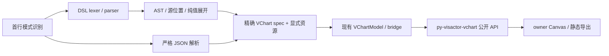

# py-mermaid 原生图表语法：VChart DSL v1

状态：**DSL v1 已实现，最终验收见 [验收记录](VCHART_DSL_ACCEPTANCE.md)**。2026-11-07，依据用户“设计新的 py-mermaid 语法，全量接入 py-vchart 能力”的要求制定并实现。本规范描述当前语法；原设计阶段及失败证据继续保留。

依赖基准为已正式发布的 `py-visactor-vchart==0.1.1`。现有 `vchart` + 严格 JSON、`render_vchart(spec)`、七类 Mermaid 图表语法继续保留。新增语法使用 **`vchart <类型>` + 属性赋值、配置块和表格数据**，统一编译到同一个 VChart spec 与公开渲染链路。

相关入口：[执行计划](VCHART_DSL_EXECUTION_PLAN.md) · [EBNF](syntax/vchart-v1.ebnf) · [68 类型与225原规格清单](../references/vchart-dsl-design.json) · [此前正式接入](VCHART_ACCEPTANCE.md)。

另有 [8组完整语法源、独立预期JSON与资源](proposals/vchart-v1/examples/README.md)。最初预期JSON预览与后续DSL实际编译、绘制分别存档，最终证据以验收记录为准。

## 1. 完整目标

1. 68 个已注册二维静态类型全部可写，包括统计规格、地图、词云、图像类和受支持的组合图；类型名直接使用公开 `VChart.supported_types()`，保留大小写和现有别名。
2. 每一个当前可用的 JSON spec 都有等价的新语法写法。数组、对象、空值、嵌套数据和任意字符串键不被简化语法限制；不要求为复杂图回退成整段 JSON。
3. 当前供应方已实现的静态字段能按原名称配置；类型专有参数保留原单位、枚举、默认值、验证和错误，不重新解释。
4. 数据和资源只做确定性编译，布局、统计计算、图元、字体及导出继续由现有公开 API 执行。新增第三方运行依赖为零。
5. 旧 JSON 模式保持严格 JSON，不因新语法增加注释、裸字符串或尾逗号。旧七类 Mermaid 语法不重写，也不改变此前验收范围。

“全量”按 **类型覆盖、参数可表达、受支持的静态效果、资源与导出链路** 分别验收。68 类型入口覆盖不能代替字段分支覆盖。供应方不支持的选项仍明确拒绝；不由语法层伪造实现。交互、动画、Dagre、video/audio、任意 HTML/CSS 扩展及3D继续按既定范围排除。

## 2. 最小示例

下面是 py-mermaid 原生新语法；第三方 Mermaid JS 工具不识别此扩展。

```text
vchart bar
size 800 420

let sales = table(month, revenue) {
  ["Jan", 120]
  ["Feb", 180]
  ["Mar", 150]
}

data = { values: $sales }
xField = "month"
yField = "revenue"

bar {
  style {
    fill = "#1664ff"
  }
}

axis bottom { type = "band" }
axis left { type = "linear"; min = 0 }
```

确定性编译结果：

```json
{
  "type": "bar",
  "width": 800,
  "height": 420,
  "data": {"values": [
    {"month": "Jan", "revenue": 120},
    {"month": "Feb", "revenue": 180},
    {"month": "Mar", "revenue": 150}
  ]},
  "xField": "month",
  "yField": "revenue",
  "bar": {"style": {"fill": "#1664ff"}},
  "axes": [
    {"orient": "bottom", "type": "band"},
    {"orient": "left", "type": "linear", "min": 0}
  ]
}
```

不新增 `x`、`y`、`color by` 等对真实字段有歧义的别名。`xField`、`seriesField`、`angleField` 等保留供应方名称；单个字段和字段数组的意义由具体类型决定。

## 3. 语法规则

### 3.1 入口与兼容

| 输入 | 解释 |
|---|---|
| 首行只有 `vchart`，随后为 JSON 对象 | 现有严格 JSON 模式 |
| 首行 `vchart bar` / `vchart kdePlot` 等 | 新 DSL v1 |
| Python `render_vchart(spec)` | 现有对象 API |
| `pie`、`xychart`、`sankey-beta` 等 | 现有 Mermaid 语法，与新 DSL 独立 |

两种文本模式均由当前已保留的 `vchart` namespace 路由，不新增或扩大原38个 Mermaid detector 分母。先识别完整首行再选择解析器；DSL 失败后不尝试 JSON 或其他图种。名称未知时列出有效类型建议，但不自动改大小写或切换相近类型。

首行允许现有 BOM 和前置空白；头部之前不允许 `%%` 注释，头部之后才启用注释。DSL v1 不引入 YAML/frontmatter 或 Mermaid init 配置；`%%{...}%%` 指令在配置位置明确诊断，字符串里的相同内容保持字面量。现有 JSON 模式的错误位置和严格性保留，原来非法但现在正式纳入 DSL 的输入需有明确兼容变更记录。

### 3.2 值、语句与注释

- 字符串使用双引号及 JSON 转义。`true`、`false`、`null`、有限 JSON 数字保留类型；普通裸词不被猜测为字符串或枚举。
- 对象与数组保留 JSON 结构；对象键可用 ASCII 标识符或双引号字符串，成员/元素用逗号分隔，DSL 模式允许一个尾逗号。
- 语句以换行或分号结束；块关闭或 EOF 可结束最后一条语句。嵌套值内部的换行是空白。
- 缩进仅用于阅读，不参与语义。`%%` 在字符串外表示行注释；颜色、SVG、URL和数据中的文本不受注释处理影响。
- 不支持表达式、函数调用、模板插值、循环、导入、Python/JS 回调。`$name` 是唯一变量引用形式，不是表达式求值。

### 3.3 属性与配置块

```text
bar.style.fill = "#1664ff"

%% 与上句等价，但不要在同一文档重复写同一属性
bar {
  style { fill = "#1664ff" }
}
```

点路径创建对象层级，双引号键与方括号键可以表达含标点或中文的真实键；对象字面量中的键从不解释为路径。示例：`"custom.key" = 1` 是一个根键，`custom.key = 1` 是两层对象。

支持显式数组索引，例如 `axes[0].orient = "bottom"`，但只能连续创建，不以 `null` 补洞。一个数组只允许采用整体字面量、连续索引或语法糖追加中的一种构造方式。

重复对象键、重复写入（即使值相同）、给已整体赋值的父对象继续打补丁、把标量当容器，均为编译错误。配置块只打开容器，互不重叠的叶子可以分块声明；整体对象/数组赋值拥有整个子树。根 `type` 由首行拥有，正文不得覆盖。

### 3.4 表格与数据形状

```text
let rows = table("月份", revenue, region) {
  ["一月", 120, "华东"]
  ["二月", null, "华南"]
}
```

`table` 仅将每行数组与表头一一配对，得到普通对象数组。表头必须非空、唯一、区分大小写；列数不符立即报错，单元格仍可为任意嵌套值。不做 CSV 猜测、类型推断、日期转换、聚合、补值、排序或行丢弃。

**数据外形由用户明确书写**：

```text
data = $rows                         %% 原始行数组，常用于统计规格
data = { values: $rows }             %% 单个 values 对象
data = [{ id: "sales", values: $rows }]  %% 有名字的数据视图数组
```

这三行是可选写法，不能在同一图里叠加。编译器不会根据类型替用户增删包装层。`histogram` / `boxPlot` 尤须保留原始数据路径和预计算数据路径的差别：0.1.1 会按数据外形及字段配置选择实际绘制分支。

`let` 是单文档纯值声明，必须先定义后使用，不得重定义或形成循环。引用展开产生独立纯值，不共享可变容器；展开过程逐节点计预算，不能先无限展开再检查大小。字符串 `"$sales"` 保持字符串。

### 3.5 少量确定性语法糖

| 新语句 | 精确含义 |
|---|---|
| `size 800 420` | 写入 `width=800`、`height=420` |
| `axis bottom { ... }` | 向根 `axes` 追加 `{orient:"bottom", ...}` |
| `series bar { ... }` | 向根 `series` 追加 `{type:"bar", ...}` |
| `resource map "local" = value` | 声明本图内联 GeoJSON，不写入 spec |
| `resource svg "regions" = value` | 声明本图内联 SVG 字符串，不写入 spec |

`size` 与直接写 `width/height` 遵循重复写入规则。`axis` 的 `orient`、`series` 的 `type` 由块头拥有，不允许正文覆盖；顺序就是最终数组顺序，不按名字重排。

根关键字只在对应语句形态下有语法意义；`series = [...]` 等仍是原字段赋值。块内是原字段，不把字段名悄悄改成另一种配置。语法糖不意味着该图支持该组件：例如统计图可能拒绝 `axes`；当前 `common` 系列只支持 `bar` 和 `line`。

## 4. 复杂图示例

### 4.1 统计绘图：直接传原始样本

```text
vchart kdePlot
size 640 360
data = table(value) {
  [-2]; [-1.2]; [-0.8]; [-0.4]; [-0.4]
  [0]; [0.1]; [0.3]; [0.6]; [1.1]; [1.8]
}
estimation { bandwidth = "scott"; bandwidthAdjust = 1 }
sampling { points = 128; cut = 3 }
```

带宽、采样点数和统计计算仍由供应方执行；DSL 不计算 KDE，也不把原始样本转成柱状图。

### 4.2 柱线与双轴组合

```text
vchart common
size 800 420
data = { values: table(month, revenue, margin) {
  ["Jan", 120, 18]
  ["Feb", 180, 24]
} }
series bar { xField = "month"; yField = "revenue" }
series line { xField = "month"; yField = "margin" }
axis bottom { type = "band" }
axis left { type = "linear"; seriesIndex = [0] }
axis right { type = "linear"; min = 0; max = 100; seriesIndex = [1] }
```

该例使用当前 `common` 的共享数据和系列索引合同。不能由此推导任意68类型均能混合、每系列独立数据或多区域布局已支持；后端未有的能力不由语法层拼出近似图替代。

### 4.3 层级数据

```text
vchart treemap
size 640 400
categoryField = "name"
valueField = "value"
data = { values: [
  {name: "Group A", children: [
    {name: "A1", value: 8},
    {name: "A2", value: 5}
  ]},
  {name: "Group B", value: 3}
] }
label { visible = false }
splitType = "binary"
nodePadding = [5, 3]
```

层级、图关系、矩阵、数组型值都可使用同样的值语法。这里 `label.visible=false` 是当前供应方的实际约束；不能因新语法出现 `label` 块就承诺标签已支持开启。传统 Mermaid `treemap` 的文字绘制合同继续独立保留。

### 4.4 桑基图：保留节点和边结构

```text
vchart sankey
size 640 400
categoryField = "name"
sourceField = "source"
targetField = "target"
valueField = "value"
label { visible = false }
data = [{ values: [{
  nodes: [{name: "Input"}, {name: "Output"}],
  links: [{source: 0, target: 1, value: 5}]
}] }]
```

节点ID、引用方式、负值及非有限值仍由原合同校验，不自动制造缺失节点。

### 4.5 地图与 SVG

```text
vchart map
resource map "local" = {
  type: "FeatureCollection",
  features: [{
    type: "Feature",
    properties: {name: "A"},
    geometry: {type: "Polygon", coordinates: [[[0,0],[0,1],[2,1],[2,0],[0,0]]]}
  }]
}
map = "local"
nameField = "name"
seriesField = "group"
data = { values: [{name: "A", group: "alpha"}] }
label { visible = false }
```

也可以不写 `resource`，由现有 `maps={...}` / CLI `--vchart-maps` 显式传入。`pictogram` / `imageCloud` 的 SVG 使用同样的内联声明或现有 `svgs` 参数，并保留真实 `svg` 字段名。

图像的 data URI / `resource:ID`、图标与字体沿用当前 `ResourceBundle`。字体路径只能由调用方显式授权的资源入口读取，不增加源文本里的任意文件加载。API/CLI与文档内联声明出现同种同名资源时，编译/绑定阶段报冲突，不使用优先级静默覆盖。命名空间 `(map,name)`、`(svg,name)` 分开。

## 5. 68 类型如何全部覆盖

类型清单以机器快照为准；以下分组去重后恰为68，不把 `histogram` / `boxPlot` 的双路径重复计数。

| 类别 | 数量 | 类型 |
|---|---:|---|
| 笛卡尔/组合 | 13 | bar、line、scatter、area、rangeArea、rangeColumn、waterfall、histogram、boxPlot、heatmap、mosaic、linearProgress、common |
| 极坐标/指标 | 6 | pie、rose、radar、gauge、circularProgress、liquid |
| 层级/关系/集合 | 7 | funnel、treemap、sunburst、circlePacking、sankey、correlation、venn |
| 二维扩展 | 14 | storyline、sequenceAnalysis、sequence、combinationCandlestick、pictogram、imageCloud、candlestick、conversionFunnel、rankingList、rankingBar、timeline、sequenceScatterPixel、sequenceScatterKDE、sequenceScatterLink |
| 地图/词云 | 2 | map、wordCloud |
| 统计独立名称 | 26 | learningCurve、seasonalPlot、timeSeriesPlot、autocorrelationPlot、residualPlot、pairedComparisonPlot、kdePlot、violinPlot、countPlot、screePlot、scatterPlot、embeddingPlot、qqPlot、stripPlot、ecdfPlot、calibrationCurve、rocCurve、precisionRecallCurve、shapBeeswarmPlot、pairPlot、hexbinPlot、featureImportancePlot、pointIntervalPlot、missingValueMatrix、correlationMatrix、confusionMatrix |

每类只复用通用编译规则，无须开发68套独立解析器。对任意现有 JSON spec：把根 `type` 移入首行，其余根属性逐个写为 `key = <值>`，值语法保留全部 JSON 结构。因此不依赖特殊缩写也能表达所有合法规格；表格和配置块只改善书写。

目前机器快照记录68个代表规格及225个原规格指纹，**尚不是全部静态字段/条件分支的完整审计**。实施前要逐 renderer 填充字段、嵌套字段、取值和条件限制清单，分开记录：真正绘制、数据计算、仅禁用值合法、静态忽略、明确拒绝。不得把代表 fixture 出现过的字段名当作完整 schema。

已核实且必须保留的条件包括：

- `common` 仅共享数据的柱线组合；双轴系列绑定使用原 `seriesIndex`，横向组合不支持右轴。
- `histogram` / `boxPlot` 的 raw-array 与预计算数据分支不同；统计图不会接受所有普通笛卡尔字段。
- Map 当前要求外环顺时针、洞逆时针，内联GeoJSON继承该校验，编译器不悄悄翻转坐标；
- Venn 最多三个单集合；Treemap 当前 `splitType` 为 binary，部分类型要求 `label.visible=false`。
- `sequenceScatterPixel` 在0.1.1实际固定300×300；与其不一致的尺寸请求须显示已核实诊断，不能把 `size` 编译成功视作尺寸生效。
- 普通 `bar` 等严格校验器不接受通用 `title` / `legends`；不设计一条看似通用却被忽略的标题/图例命令。对应类型确有支持时，直接使用其真实字段。
- 交互/动画按现有静态范围排除。若输出静态忽略诊断，只标记已核实的配置路径，不把数据记录中同名的 `events` 等键误判为选项。

## 6. 编译与集成架构



解析、编译、资源校验都返回纯值，不创建 Canvas/字体/设备对象。统计与布局不在编译阶段执行。绘制保持 owner线程，跨线程只传纯值或字节。

建议文件边界：

| 位置 | 责任 |
|---|---|
| `parsing/vchart_dsl/lexer.py` | 分词、注释、数字/字符串与原始位置 |
| `parsing/vchart_dsl/parser.py` | AST、块、表格、变量引用，不做布局 |
| `model/vchart_dsl.py` | 冻结 AST / span / 编译结果类型 |
| `parsing/vchart_dsl/compiler.py` | 变量展开、写入冲突、结构等价、资源提取 |
| `diagrams/charts/vchart.py` | 双文本模式分派，复用既有 provider |
| `vchart_bridge.py` | 复用预算、现有模型、inline/API资源冲突处理及渲染 |
| `api.py` / `__init__.py` / CLI | 可检查编译结果，原render入口接入，诊断输出 |

`Diagram.model` 继续保持 `VChartModel`，以兼容当前 API 的 `isinstance` 分支。可追加具有默认值的纯资源/源位置元数据，或在现有 Diagram 纯元数据中承载；不能直接换成另一种包装对象而漏掉现有编码分支。

建议新增公开 `compile_vchart(text)`：返回可复制的 spec、内联地图/SVG、源映射、模式和诊断。它只证明解析/结构/基础预算有效；完整类型选项仍由正式供应方验证和渲染。Python spec API不绕经文本编译器，现有 `render/arender` 自动处理两种文本模式，CLI格式/后端/资源参数沿用现有入口。

导出格式、质量、density、GPU/CPU选择由 API/CLI 的现有参数控制，不在源文本里新增一套冲突的执行配置。文字和HTML内容保留当前静态资源/安全边界，不通过 Mermaid 预处理器改写 spec。

## 7. 诊断、预算和来源

新语法层至少提供：`VCHART_DSL_SYNTAX`、`VCHART_DSL_DUPLICATE_WRITE`、`VCHART_DSL_PATH_CONFLICT`、`VCHART_DSL_TABLE_ARITY`、`VCHART_DSL_REFERENCE`、`VCHART_DSL_RESOURCE_CONFLICT`。未知类型、基础尺寸、资源和预算继续使用既有明确错误类别。

语法/编译错误必须给出原始行列、UTF-16偏移、片段及目标spec路径；引用错误关联声明和使用位置。AST span不能以生成的 JSON 位置代替原文。供应方若只返回无结构的错误文本，就保留其真实消息并定位到可靠的类型/相关语句范围，不编造某个精确字段位置。

文档上限沿现有8 MiB，值深度128、展开后值节点最多1,000,000；展开边建边计数。现有尺寸/像素及资源单项32 MiB、bundle128 MiB预算继续适用；内联资源还受源文本总大小约束，大资源使用显式API/CLI。任何编译路径都不能通过引用、嵌套、非法数值或表格跳过既有校验。

`schema/version`、完整源文本/原spec/资源SHA、编译后spec、源位置映射、供应方版本及实际后端均纳入标准Run。字符串、数据数组顺序、空数组/对象、布尔与数字区分必须保留；不因 `False == 0` 等 Python 比较规则而误判结构等价。

## 8. 验收定义

完成条件及执行顺序见[执行计划](VCHART_DSL_EXECUTION_PLAN.md)。核心门禁是：

- 68个实际类型均可通过新DSL调用；225个现有规格均有结构等价的编译结果。
- 手写语法特性案例独立覆盖表格、变量、配置块、路径、组合和资源；不能只做自动“JSON去括号”往返。
- 同一编译spec与现有spec API在各后端的实际图元/文字/数据/几何一致，静态导出有效；确定性的输出另外核同后端字节，不跨后端要求字体像素相等。
- 至少保留JSON入口、七语法、旧31图、数学/ELK、资源、异步、CLI和安装回归。原22条分支缺口维持原分类，不计入本轮已修复。
- 报告为新的“第六轮 · VChart DSL”，按最多12例分页，分开展示编译等价、语法负例、实际绘图与原生限制；不把编译成功或报告成功当作完整渲染通过。

语法、数据与组件映射现已实现。类型派发及高风险条件的源码索引见能力清单；它是有限审计，不是供应方所有字段/分支的穷尽覆盖证明。最终运行、已知限制及完整证据见 [验收记录](VCHART_DSL_ACCEPTANCE.md)。
