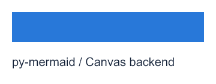
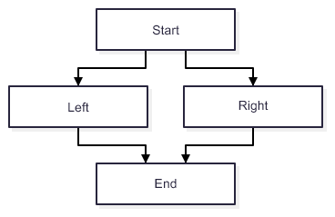

# 可运行示例

[canvas_smoke.py](canvas_smoke.py) 仅验证固定 Canvas 依赖：绘制 360×140 白底蓝矩形与测量文字，检查内部 RGBA、PNG 尺寸，并记录实际 engine、版本、脚本/图片 SHA。**没有 Mermaid 解析、布局或渲染。**

安装 CPython 3.13 和 `py-skia-canvas==0.1.0a18` 后，在仓库根执行：

```shell
python examples/canvas_smoke.py --out test-runs/new-example-auto
python examples/canvas_smoke.py --backend cpu --out test-runs/new-example-cpu
python examples/canvas_smoke.py --backend gpu --out test-runs/new-example-gpu
```

`--out` 必须是新目录；输出 `canvas.png` 和 `result.json`。`auto` 保留 Canvas 选择；`cpu` 使用公开 setter；`gpu` 要求实际 engine 为 GPU，不能回退后称通过。engine 记录和这个小样例不构成 native GPU 路径或全 API 验收。

系统字体影响文字外观；本例不捆绑字体、不访问网络。所有 Canvas 对象留在当前调用线程；背景显式白色。实际本批记录见 [发布状态](../docs/RELEASE_STATUS.md)。

以下是本例在 Windows / Canvas 0.1.0a18 / NVIDIA Vulkan GPU 的原始输出，未经后处理；[manifest](../docs/assets/manifest.json)记录脚本、输出 SHA 与来源 run。这是依赖示例图，不是 Mermaid 图。


# F01.1 基础流程图示例

[basic_flowchart.py](basic_flowchart.py) 输入真实Mermaid分支/合流文本，经Python解析、Canvas测量、真实ELK布局和Canvas输出PNG。安装本地包后运行：

```shell
python examples/basic_flowchart.py --out test-runs/new-flowchart.png
python examples/basic_flowchart.py --backend cpu --out test-runs/new-flowchart-cpu.png
```

已有输出文件拒绝覆盖。脚本使用受保护main入口；生产不使用Node/browser/JS。支持边界见 [使用说明](../docs/F01_1_USAGE.md)。真实本地样例与来源指纹见 [样例清单](../docs/assets/f011-manifest.json)。


